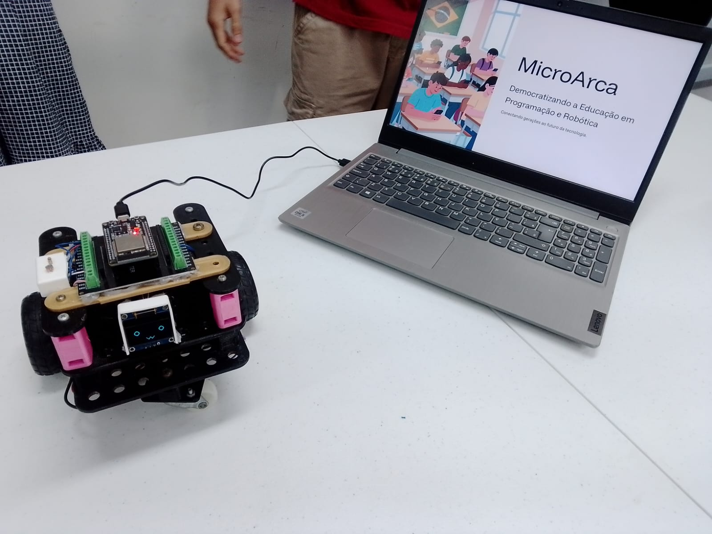
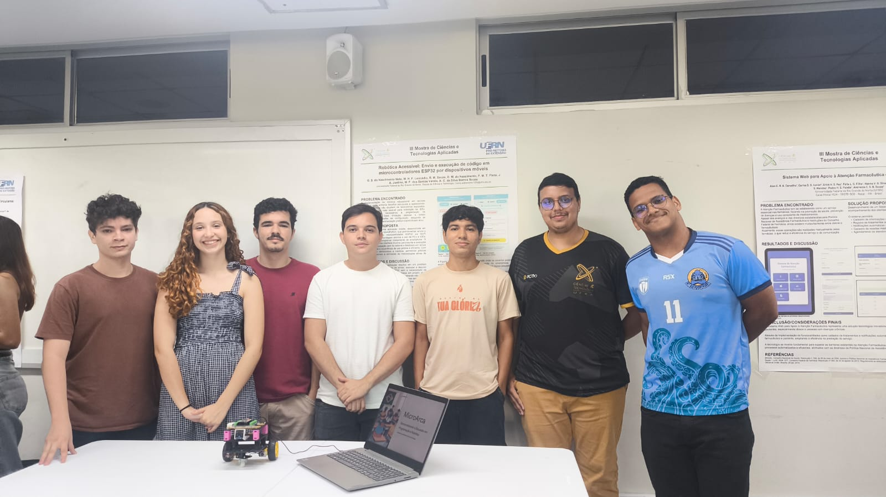

# 🤖 MicroARCA

## Revisão atual do MicroARCA

O código desta revisão reúne o aplicativo Android **1.2.4+9**, os módulos
MicroPython da placa e seus testes. Inclui mudanças posteriores aos ensaios
da monografia, que utilizaram também versões anteriores do aplicativo.
O histórico de versões está em [release_notes](micro_arca_app/release_notes/).
Consulte os [testes automatizados](docs/testes-automatizados.md) e as
[demonstrações com fotos, exemplos e vídeos](https://github.com/gabriel26077/MicroARCA-demonstracoes).

O catálogo de bibliotecas está em [SistemaMicroARCA](https://github.com/gabriel26077/SistemaMicroARCA).
Os créditos do protótipo coletivo e da continuidade estão em [AUTHORS.md](AUTHORS.md).
Os avisos dos componentes externos estão em [THIRD_PARTY_NOTICES.md](THIRD_PARTY_NOTICES.md).

## Licença

O código próprio do MicroARCA e sua documentação de software estão disponíveis
sob a [licença MIT](LICENSE), com os créditos do protótipo coletivo preservados
em [AUTHORS.md](AUTHORS.md). A licença permite uso, modificação e redistribuição,
inclusive comercial, mantendo os avisos de autoria e licença.

Os componentes de terceiros conservam suas próprias licenças: Blockly sob
Apache 2.0 e Fira Code sob SIL Open Font License 1.1, conforme os
[avisos de terceiros](THIRD_PARTY_NOTICES.md).

> ⚠️ **Nota:** Este projeto encontra-se atualmente em fase de **MVP (Mínimo Produto Viável)**.

O **ProjetoARCA** (**A**prendizado, **R**obótica e **C**omputação **A**cessível) é uma iniciativa que nasceu para democratizar o ensino de robótica e programação em escolas. 

Embora o aprendizado de tecnologia esteja cada vez mais presente na educação básica, os custos elevados de kits tradicionais e a necessidade de computadores potentes ou laboratórios dedicados ainda barram o acesso da maioria das escolas.

A proposta do **ProjetoARCA** é quebrar essa barreira financeira através de um **ecossistema de robótica e programação de baixo custo**, que não necessita de infraestrutura de ponta e funciona **diretamente pelo celular**.

---

## 💡 Como Funciona?

O ecossistema é composto por duas frentes integradas que se comunicam de forma simples:

1. **📱 Aplicativo Móvel (`micro_arca_app/`):** Um ambiente de programação visual e amigável rodando diretamente no smartphone do aluno, permitindo programar e enviar comandos de forma descomplicada.
2. **🔌 Sistema Embarcado (`embedded/`):** Códigos em **MicroPython** carregados no ESP32 clássico, com acesso ao interpretador por **Bluetooth BLE**. O app Android descobre o kit, envia o programa e recebe a saída do console sem configurar Wi-Fi ou IP.

### Conexão Bluetooth (Android)

A migração BLE está na fase de validação em bancada. O envio usa arquivo temporário
e verificação SHA-256; execução e parada são confirmadas pelo interpretador.
Veja o **[guia de instalação, uso e testes](embedded/README.md)** para carregar os
cinco arquivos necessários na placa. A placa atende um celular por vez.

Esse dispositivo embarcado é extremamente versátil e pode dar vida a:
- Um pequeno robô móvel.
- Uma maquete inteligente escolar (ex: automação de luzes de uma casinha didática, sensores de presença).
- Qualquer sistema experimental ou protótipo que a imaginação dos alunos permitir.

### 📸 Demonstração e Galeria

#### 📱 Aplicativo (Interface do Usuário)
As imagens abaixo registram a interface anterior à migração BLE. A conexão atual
é iniciada pelo **botão Bluetooth** na parte superior da tela:

  
  
  

#### 🤖 O Protótipo e a Equipe
Veja abaixo o primeiro protótipo funcional do robô físico montado com componentes acessíveis e a equipe fundadora do projeto:

  
  

---

## 📂 Estrutura do Repositório

O repositório está organizado de forma modular:

* 📱 **[micro_arca_app/](./micro_arca_app/)**: Contém o aplicativo mobile desenvolvido em Flutter.
* 🔌 **[embedded/](./embedded/)**: Guarda o transporte BLE do REPL, o upload verificado e os scripts de inicialização do ESP32.

---

## 🚀 Como Contribuir

Se você é um desenvolvedor e deseja configurar o ambiente de desenvolvimento local, confira o nosso guia passo a passo em:

👉 **[Guia de Contribuição (CONTRIBUTING.md)](./CONTRIBUTING.md)**

---

## 👥 Equipe Fundadora

Este projeto foi idealizado e construído com extrema dedicação pela sua equipe fundadora:

* 🎓 **Gabriel Sebastião do Nascimento Neto**
* 🎓 **Maria Helena Fernandes Leocádio**
* 🎓 **Rodrigo de Menezes Souza**
* 🎓 **Francisco Micarlos Teixeira Pinto**
* 🎓 **Moisés Frederico dos Santos Varela**
* 🎓 **Judyson Andrade Justino**
* 🎓 **Daniel Moura do Nascimento**
