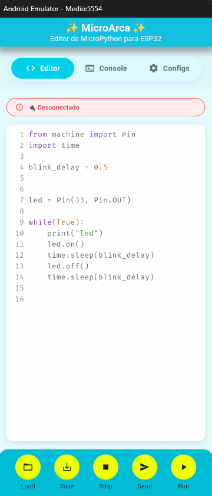
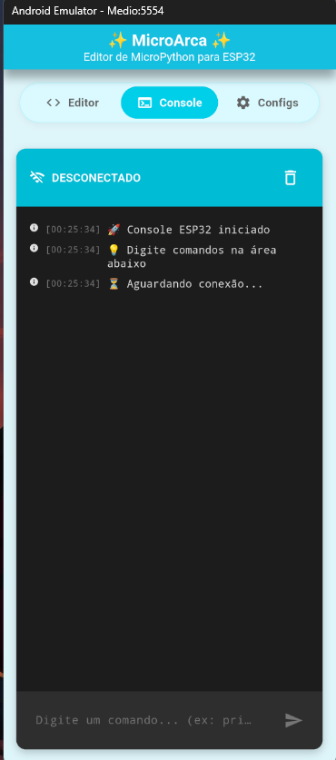
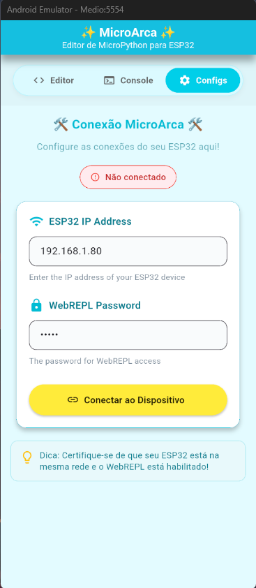

# 🤖 ProjetoARCA

> ⚠️ **Nota:** Este projeto encontra-se atualmente em fase de **MVP (Mínimo Produto Viável)**.

O **ProjetoARCA** (**A**prendizado, **R**obótica e **C**omputação **A**cessível) é uma iniciativa que nasceu para democratizar o ensino de robótica e programação em escolas. 

Embora o aprendizado de tecnologia esteja cada vez mais presente na educação básica, os custos elevados de kits tradicionais e a necessidade de computadores potentes ou laboratórios dedicados ainda barram o acesso da maioria das escolas.

A proposta do **ProjetoARCA** é quebrar essa barreira financeira através de um **ecossistema de robótica e programação de baixo custo**, que não necessita de infraestrutura de ponta e funciona **diretamente pelo celular**.

---

## 💡 Como Funciona?

O ecossistema é composto por duas frentes integradas que se comunicam de forma simples:

1. **📱 Aplicativo Móvel (`micro_arca_app/`):** Um ambiente de programação visual e amigável rodando diretamente no smartphone do aluno, permitindo programar e enviar comandos de forma descomplicada.
2. **🔌 Sistema Embarcado (`embedded/`):** Códigos em **MicroPython** carregados no microcontrolador (ESP32) que servem como presets e interpretadores para entender e executar a comunicação enviada pelo aplicativo. 

Esse dispositivo embarcado é extremamente versátil e pode dar vida a:
- Um pequeno robô móvel.
- Uma maquete inteligente escolar (ex: automação de luzes de uma casinha didática, sensores de presença).
- Qualquer sistema experimental ou protótipo que a imaginação dos alunos permitir.

### 📸 Demonstração e Galeria

#### 📱 Aplicativo (Interface do Usuário)
Abaixo estão as telas principais do aplicativo, onde os alunos podem escrever e enviar seus códigos, monitorar o console de execução em tempo real e realizar a configuração inteligente da rede local:

  
  
  

#### 🤖 O Protótipo e a Equipe
Veja abaixo o primeiro protótipo funcional do robô físico montado com componentes acessíveis e a equipe fundadora do projeto:

  
  

---

## 📂 Estrutura do Repositório

O repositório está organizado de forma modular:

* 📱 **[micro_arca_app/](./micro_arca_app/)**: Contém o aplicativo mobile desenvolvido em Flutter.
* 🔌 **[embedded/](./embedded/)**: Guarda os scripts em MicroPython (incluindo gerenciamento de resets rápidos e Wi-Fi inteligentes) que rodam no ESP32.

---

## 🚀 Como Contribuir

Se você é um desenvolvedor e deseja configurar o ambiente de desenvolvimento local, confira o nosso guia passo a passo em:

👉 **[Guia de Contribuição (CONTRIBUTING.md)](./CONTRIBUTING.md)**

---

## 👥 Equipe Fundadora

Este projeto foi idealizado e construído com extrema dedicação pela sua equipe fundadora:

* 🎓 **Gabriel Sebastião do Nascimento Neto**
* 🎓 **Maria Helena Fernandes Leocádio**
* 🎓 **Rodrigo de Menezes Souza**
* 🎓 **Francisco Micarlos Teixeira Pinto**
* 🎓 **Moisés Frederico dos Santos Varela**
* 🎓 **Judyson Andrade Justino**
* 🎓 **Daniel Moura do Nascimento**