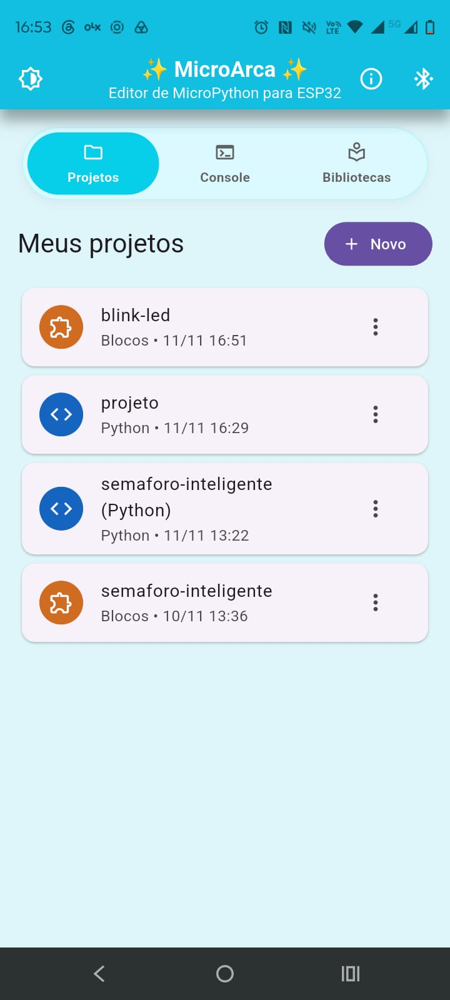
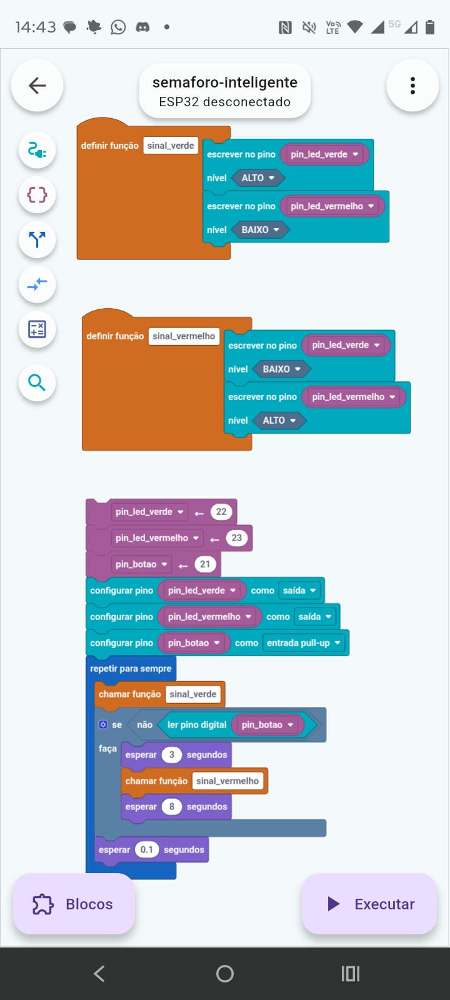
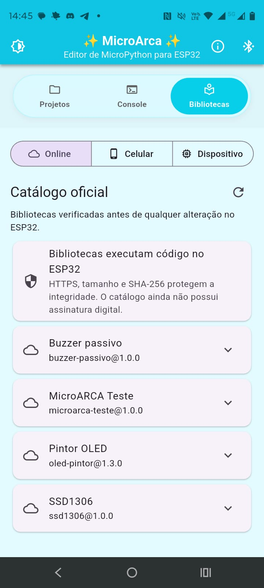
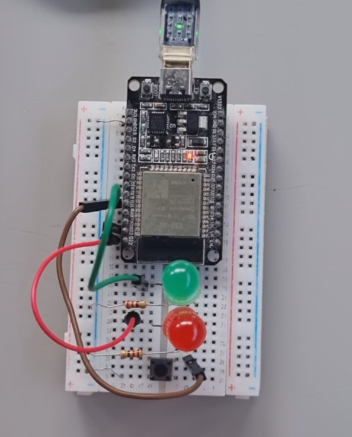

# MicroARCA

**Programação de microcontroladores pelo celular, com blocos visuais e MicroPython.**

O MicroARCA permite criar programas em um aplicativo Android e enviá-los ao ESP32 por Bluetooth Low Energy (BLE). O console mostra mensagens e erros e permite responder às solicitações do programa. Um catálogo de bibliotecas acrescenta funções e blocos, como os utilizados para desenhar em uma tela OLED.

Este repositório reúne o código do aplicativo, os módulos instalados na placa e os exemplos e registros do TCC de **Gabriel Sebastião do Nascimento Neto**, na Universidade Federal do Rio Grande do Norte (UFRN), sob orientação de **Marcelo Nogueira**.

  
  &nbsp;
  
  &nbsp;
  

*As capturas mostram a versão 1.2.3. O código atual do aplicativo é a versão 1.2.4+9.*

## Explore o projeto

| Material | Conteúdo |
| --- | --- |
| [Aplicativo Android](micro_arca_app/) | Editores de blocos e Python, projetos, console e conexão Bluetooth. |
| [Módulos da placa e preparação](embedded/README.md) | Arquivos MicroPython e instruções de instalação no ESP32. |
| [Demonstrações em vídeo](demonstracoes/docs/demonstracoes.md) | Sete registros no YouTube, associados aos exemplos e às montagens. |
| [Montagens e ligações](demonstracoes/docs/montagens.md) | LEDs, botão e OLED: componentes, pinos, fotografias e diagramas de montagem. |
| [Exemplos de código](demonstracoes/README.md) | Semáforo convertido dos blocos, projeto Python em dois arquivos e exemplo OLED. |
| [Testes automatizados](docs/testes-automatizados.md) | Como executar as verificações e qual o alcance dos resultados. |

## Do programa à montagem

O usuário cria um projeto em blocos ou em texto. O aplicativo guarda o projeto no celular, envia seus arquivos à placa e acompanha a execução pelo console. Nos projetos em blocos, a conversão para MicroPython acontece no próprio celular antes do envio.

O ESP32 precisa ser preparado previamente com o firmware MicroPython e os cinco arquivos-base do MicroARCA. Essa preparação inicial utiliza um computador e um cabo USB. Depois, as demonstrações de programação pelo celular utilizam BLE; a placa pode receber alimentação de um carregador USB.

  

No exemplo acima, o sinal permanece verde até o acionamento do botão. Após três segundos, muda para vermelho por oito segundos e volta ao verde. O programa utiliza variáveis, funções, repetição e uma condição. Estão disponíveis os [blocos](demonstracoes/imagens/semaforo-botao/blocos.jpeg), as [ligações](demonstracoes/docs/montagens.md#semáforo-com-botão), o [Python convertido](demonstracoes/exemplos/semaforo-com-botao/main.py) e o [vídeo da conversão](https://youtube.com/shorts/yihG3YCMe60).

## Recursos demonstrados

- Programação em blocos e conversão de um projeto em blocos para Python.
- Projetos Python com vários arquivos e importação de funções entre eles.
- Mensagens, identificação de erros e entrada de dados pelo console.
- Leitura de botão e acionamento de LEDs.
- Instalação de biblioteca e uso de seus blocos para escrever e desenhar em OLED.
- Preservação dos projetos no celular e execução de programa ao ligar a placa.

As demonstrações registram funcionamento nas configurações utilizadas. Não constituem avaliação de aprendizagem ou de usabilidade com estudantes, nem garantia de compatibilidade com qualquer placa. O [índice dos vídeos](demonstracoes/docs/demonstracoes.md) distingue as versões e os exemplos de cada registro.

## Usar e desenvolver

Comece pela [preparação da placa](embedded/README.md). No aplicativo, o botão Bluetooth da tela inicial permite procurar kits ou reencontrar um kit associado. As abas reúnem os projetos, o console e as bibliotecas.

Para preparar o ambiente de desenvolvimento, consulte o [guia de contribuição](CONTRIBUTING.md). O código atual inclui ajustes posteriores aos ensaios da monografia; as [notas de versões](micro_arca_app/release_notes/) e a [documentação da associação Android](docs/companion-device-manager.md) detalham essa evolução.

O código do catálogo e suas bibliotecas estão em [SistemaMicroARCA](https://github.com/gabriel26077/SistemaMicroARCA). O [inventário dos materiais](demonstracoes/docs/origem.md) identifica a procedência das imagens e dos programas de demonstração.

## Origem e autoria

O trabalho dá continuidade ao protótipo coletivo do **ProjetoARCA**, desenvolvido em 2025. As fotografias abaixo mostram o primeiro robô e a equipe fundadora dessa etapa.

<table>
  <tr>
    <td width="50%" align="center" valign="top">
      
       <strong>Primeiro protótipo — 2025</strong>
    </td>
    <td width="50%" align="center" valign="top">
      
       <strong>Equipe fundadora — 2025</strong>
    </td>
  </tr>
</table>

Os integrantes da equipe e os créditos da continuidade estão em [AUTHORS.md](AUTHORS.md). O desenvolvimento posterior e a documentação contaram com apoio de modelos de IA, conforme declarado na monografia. As contribuições permanecem registradas no histórico Git.

## Licença

O código próprio do MicroARCA e sua documentação de software estão sob a [licença MIT](LICENSE). Ela permite uso, modificação e redistribuição, inclusive comercial, mantendo os avisos de autoria e licença.

Os componentes externos conservam suas licenças, incluindo Blockly sob Apache 2.0 e Fira Code sob SIL Open Font License 1.1. Consulte [THIRD_PARTY_NOTICES.md](THIRD_PARTY_NOTICES.md).
