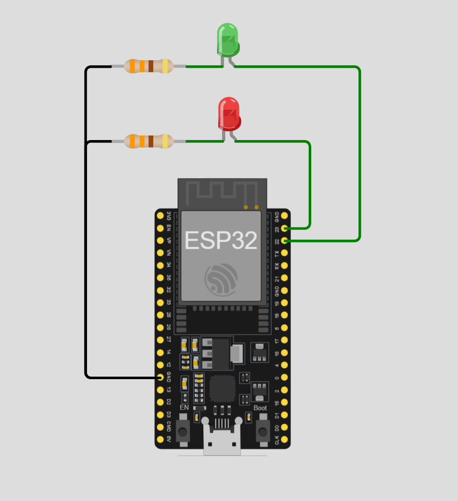
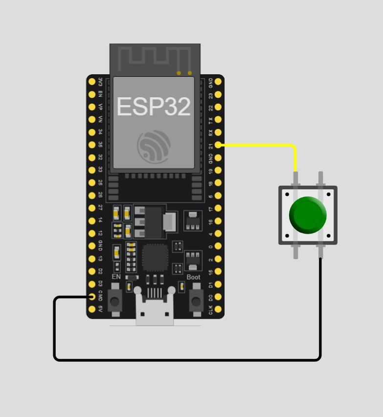
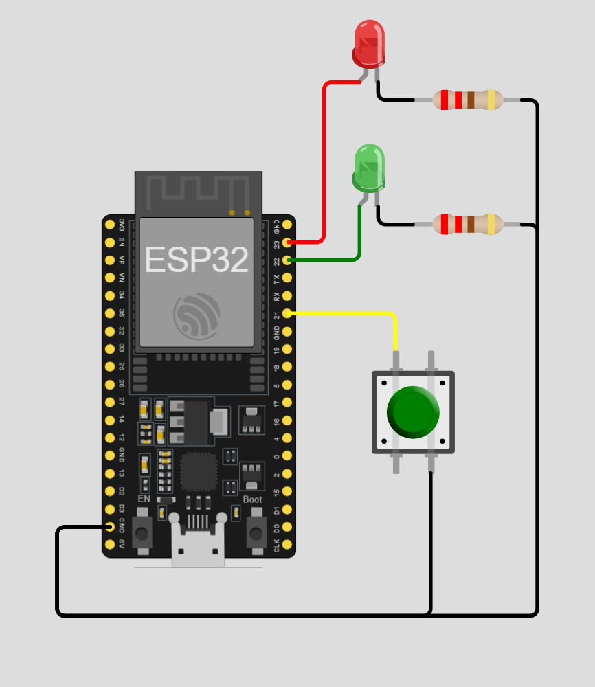
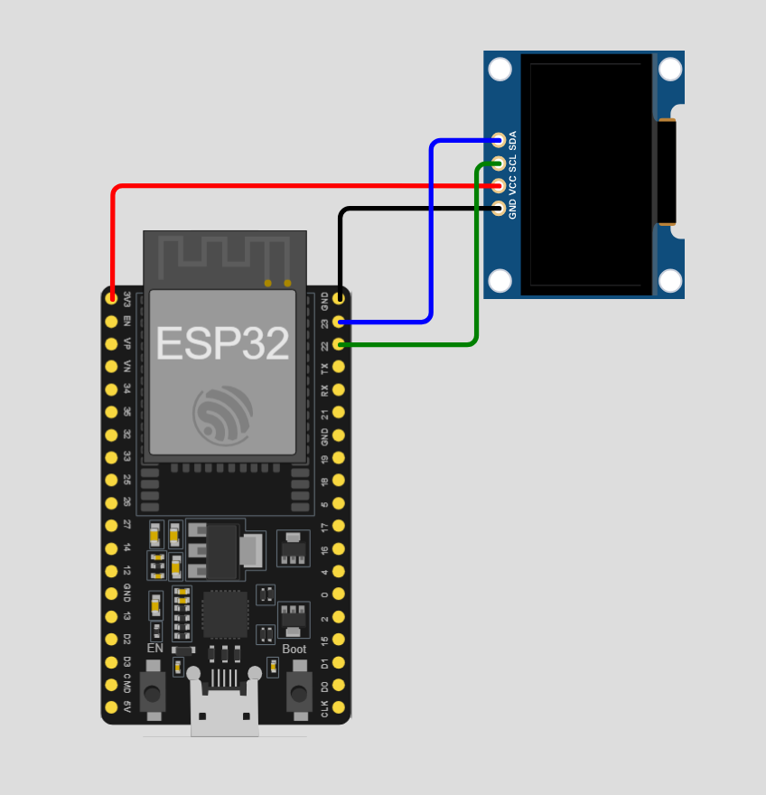

# Montagens e ligações

As montagens utilizam um ESP32 genérico clássico e uma protoboard de 400 pontos. Nas demonstrações manuais, a placa foi alimentada por um carregador de celular, com cabo USB fornecendo 5 V. Os sinais dos pinos são de 3,3 V. As imagens de ligações foram preparadas no Wokwi; as fotografias mostram as montagens reais.

## Semáforo simples

Dois LEDs de 10 mm alternam entre verde e vermelho. Cada LED utiliza um resistor de 330 Ω em série.

| Elemento | Ligação |
| --- | --- |
| LED verde | GPIO 22, com resistor em série |
| LED vermelho | GPIO 23, com resistor em série |
| Retorno dos LEDs | GND |

[Fotografia da montagem](../imagens/semaforo/montagem.jpeg) · [Vídeo](https://youtube.com/shorts/4j4VN3_md6g)

## Leitura de botão

O botão liga o GPIO 21 ao GND quando pressionado. O programa configura esse pino como entrada com pull-up interno: a leitura é alta quando o botão está solto e baixa quando pressionado. O estado aparece no console do aplicativo.

[Blocos](../imagens/botao/blocos.jpeg) · [Saída no console](../imagens/botao/console.jpeg) · [Vídeo](https://youtu.be/rywTD_ZDoG4)

## Semáforo com botão

O sinal permanece verde até o acionamento do botão. Após três segundos, muda para vermelho por oito segundos e retorna ao verde. O programa utiliza funções para os dois estados e variáveis para identificar os pinos.

| Elemento | Ligação |
| --- | --- |
| LED verde de 10 mm | GPIO 22, com resistor de 220 Ω em série |
| LED vermelho de 10 mm | GPIO 23, com resistor de 220 Ω em série |
| Botão | Entre GPIO 21 e GND; pull-up interno |
| Retorno dos LEDs | GND |

[Fotografia](../imagens/semaforo-botao/montagem.png) · [Blocos no celular](../imagens/semaforo-botao/blocos.jpeg) · [Python convertido](../exemplos/semaforo-com-botao/main.py) · [Vídeo](https://youtube.com/shorts/Z60QdG66KMw)

## Tela OLED

A tela OLED I2C de 0,96 polegada tem resolução de 128 × 64 pixels. A biblioteca instalada pelo catálogo fornece as funções utilizadas pelos blocos para escrever e desenhar.

| Pino da tela | ESP32 |
| --- | --- |
| VCC | 3,3 V |
| GND | GND |
| SCL | GPIO 22 |
| SDA | GPIO 23 |

[Fotografia](../imagens/oled/montagem.jpeg) · [Blocos](../imagens/oled/blocos.jpeg) · [Código do exemplo fotográfico](../exemplos/tela-oled/main.py) · [Vídeo](https://youtube.com/shorts/W23DYBzJblE)

[Voltar à apresentação](../README.md)
