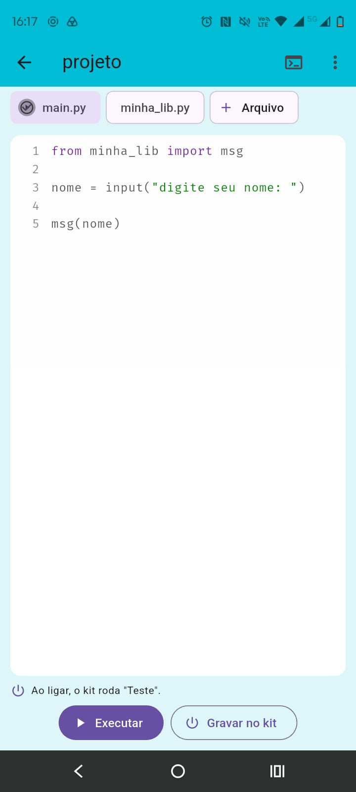
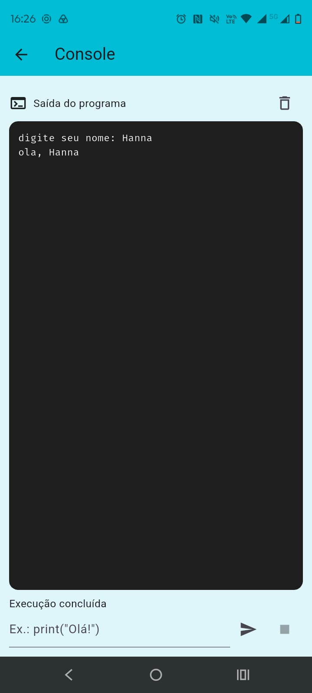

# Projeto Python em dois arquivos

O arquivo [main.py](main.py) solicita um nome pelo console e chama a função msg(), definida em [minha_lib.py](minha_lib.py). A função exibe uma saudação com o nome recebido.

Os dois arquivos foram transcritos das capturas de tela do programa funcional, com os nomes necessários à importação. Não são uma exportação byte a byte dos arquivos da placa. Para reproduzir, crie os dois arquivos no mesmo projeto Python do aplicativo.

No [vídeo](https://youtube.com/shorts/oPV4c6HjdaU), também aparece um erro de digitação em print(), seguido de sua correção. Os arquivos desta pasta representam a versão corrigida.

  
  &nbsp;&nbsp;
  

[Captura da mensagem de erro](../../imagens/python/erro.jpeg) · [Voltar à apresentação](../../README.md)
