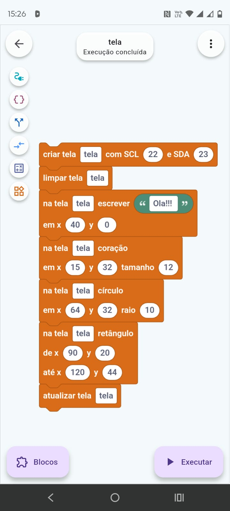

# Tela OLED: exemplo fotográfico

[main.py](main.py) preserva o código gerado para o exemplo fotografado: texto, coração, círculo e retângulo. Os limites numéricos presentes nas chamadas fazem parte do código registrado e foram mantidos.

O programa depende da biblioteca **Pintor OLED**, instalada pelo catálogo do MicroARCA. O exemplo do trabalho utiliza Pintor OLED 1.3.0 e SSD1306 1.0.0. Os arquivos dessas bibliotecas não estão incluídos neste repositório.

O vídeo OLED demonstra outro desenho. Portanto, este arquivo corresponde às fotografias e aos blocos abaixo, sem pretender ser uma transcrição do programa exibido naquele vídeo.

  

[Resultado na montagem](../../imagens/oled/montagem.jpeg) · [Ligações](../../docs/montagens.md#tela-oled) · [Vídeo OLED](https://youtube.com/shorts/W23DYBzJblE)
